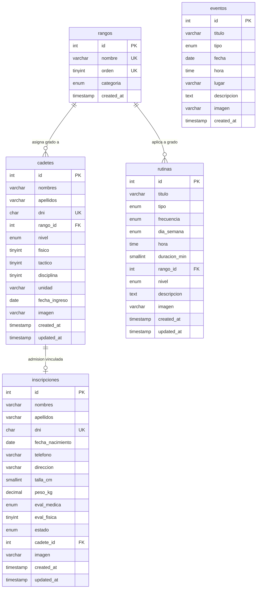

# Diseño de Base de Datos · Centro de Mando y Control Operativo (Ejército del Perú)

Este documento contiene la estructura, diagrama y especificación técnica de la base de datos relacional para el sistema de gestión del Ejército del Perú, alineado a los estándares de desarrollo de **Innovex Corp**.

---

## 1. Diagrama de Relación Entidad-Relación (ERD)

---

## 2. Definición de Tablas Principales

### 2.1 `rangos` (Escalafón Militar Oficial)
* **id**: `INT UNSIGNED AUTO_INCREMENT PRIMARY KEY`
* **nombre**: `VARCHAR(40) NOT NULL UNIQUE` (Soldado, Cabo, Alférez, Teniente, Capitán, etc.)
* **orden**: `TINYINT UNSIGNED NOT NULL UNIQUE` (Jerarquía 1 al 12)
* **categoria**: `ENUM('Tropa', 'Suboficial', 'Oficial', 'Oficial Superior', 'General')`
* **created_at**: `TIMESTAMP`

### 2.2 `cadetes` (Efectivos Militares en Servicio)
* **id**: `INT UNSIGNED AUTO_INCREMENT PRIMARY KEY`
* **nombres**: `VARCHAR(60) NOT NULL`
* **apellidos**: `VARCHAR(80) NOT NULL`
* **dni**: `CHAR(8) NOT NULL UNIQUE` (Validación REGEXP `^[0-9]{8}$`)
* **rango_id**: `INT UNSIGNED NOT NULL FK -> rangos(id)`
* **nivel**: `ENUM('Nuevo', 'Avanzado') DEFAULT 'Nuevo'`
* **fisico**: `TINYINT UNSIGNED CHECK (0-100)`
* **tactico**: `TINYINT UNSIGNED CHECK (0-100)`
* **disciplina**: `TINYINT UNSIGNED CHECK (0-100)`
* **unidad**: `VARCHAR(80) DEFAULT 'Centro de Instrucción'`
* **fecha_ingreso**: `DATE NOT NULL`
* **imagen**: `VARCHAR(255) NULL`
* **created_at**, **updated_at**: `TIMESTAMP`

### 2.3 `rutinas` (Plan de Instrucción y Entrenamiento)
* **id**: `INT UNSIGNED AUTO_INCREMENT PRIMARY KEY`
* **titulo**: `VARCHAR(80) NOT NULL`
* **tipo**: `ENUM('Entrenamiento físico', 'Instrucción de combate', 'Supervivencia')`
* **frecuencia**: `ENUM('Diaria', 'Semanal') DEFAULT 'Diaria'`
* **dia_semana**: `ENUM('Lunes','Martes','Miércoles','Jueves','Viernes','Sábado','Domingo')`
* **hora**: `TIME NOT NULL`
* **duracion_min**: `SMALLINT UNSIGNED CHECK (10-720)`
* **rango_id**: `INT UNSIGNED NULL FK -> rangos(id)`
* **nivel**: `ENUM('Todos', 'Nuevo', 'Avanzado')`
* **descripcion**: `TEXT NULL`
* **imagen**: `VARCHAR(255) NULL`

### 2.4 `eventos` (Maniobras y Ceremonias)
* **id**: `INT UNSIGNED AUTO_INCREMENT PRIMARY KEY`
* **titulo**: `VARCHAR(100) NOT NULL`
* **tipo**: `ENUM('Ceremonia', 'Maniobra', 'Simulacro', 'Fecha clave')`
* **fecha**: `DATE NOT NULL`
* **hora**: `TIME NULL`
* **lugar**: `VARCHAR(100) NULL`
* **descripcion**: `TEXT NULL`
* **imagen**: `VARCHAR(255) NULL`

### 2.5 `inscripciones` (Admisión y Triaje Biocientífico)
* **id**: `INT UNSIGNED AUTO_INCREMENT PRIMARY KEY`
* **nombres**: `VARCHAR(60) NOT NULL`
* **apellidos**: `VARCHAR(80) NOT NULL`
* **dni**: `CHAR(8) NOT NULL UNIQUE`
* **fecha_nacimiento**: `DATE NOT NULL`
* **telefono**: `VARCHAR(15) NULL`
* **direccion**: `VARCHAR(120) NULL`
* **talla_cm**: `SMALLINT UNSIGNED CHECK (120-230)`
* **peso_kg**: `DECIMAL(5,1) UNSIGNED CHECK (35.0-200.0)`
* **eval_medica**: `ENUM('Pendiente', 'Apto', 'Apto con observaciones', 'No apto')`
* **eval_fisica**: `TINYINT UNSIGNED CHECK (0-100)`
* **estado**: `ENUM('Pendiente', 'Aprobado', 'Rechazado')`
* **cadete_id**: `INT UNSIGNED NULL UNIQUE FK -> cadetes(id)`
* **imagen**: `VARCHAR(255) NULL`

---

## 3. Vistas SQL de Business Intelligence
* `vw_cadetes_escalafon`: Escalafón general con cálculo de promedio general ponderado y condición operativa.
* `vw_estadisticas_mando`: Totales, conteo de nuevos/avanzados y medias de rendimiento físico, táctico y disciplina.
* `vw_postulantes_aptos`: Postulantes aptos médicamente para evaluación física final.
