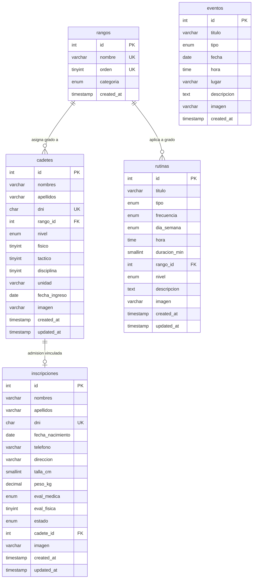

# Diseño de Base de Datos · Centro de Mando y Control Operativo (Ejército del Perú)

Este documento contiene la estructura, diagrama y especificación técnica de la base de datos relacional para el sistema de gestión del Ejército del Perú, alineado a los estándares de desarrollo de **Innovex Corp**.

---

## 1. Diagrama de Relación Entidad-Relación (ERD)



---

## 2. Definición de Tablas Principales

### 2.1 `rangos` (Escalafón Militar Oficial)
* **id**: `INT UNSIGNED AUTO_INCREMENT PRIMARY KEY`
* **nombre**: `VARCHAR(40) NOT NULL UNIQUE` (Soldado, Cabo, Alférez, Teniente, Capitán, etc.)
* **orden**: `TINYINT UNSIGNED NOT NULL UNIQUE` (Jerarquía 1 al 12)
* **categoria**: `ENUM('Tropa', 'Suboficial', 'Oficial', 'Oficial Superior', 'General')`
* **created_at**: `TIMESTAMP`

### 2.2 `cadetes` (Efectivos Militares en Servicio)
* **id**: `INT UNSIGNED AUTO_INCREMENT PRIMARY KEY`
* **nombres**: `VARCHAR(60) NOT NULL`
* **apellidos**: `VARCHAR(80) NOT NULL`
* **dni**: `CHAR(8) NOT NULL UNIQUE` (Validación REGEXP `^[0-9]{8}$`)
* **rango_id**: `INT UNSIGNED NOT NULL FK -> rangos(id)`
* **nivel**: `ENUM('Nuevo', 'Avanzado') DEFAULT 'Nuevo'`
* **fisico**: `TINYINT UNSIGNED CHECK (0-100)`
* **tactico**: `TINYINT UNSIGNED CHECK (0-100)`
* **disciplina**: `TINYINT UNSIGNED CHECK (0-100)`
* **unidad**: `VARCHAR(80) DEFAULT 'Centro de Instrucción'`
* **fecha_ingreso**: `DATE NOT NULL`
* **imagen**: `VARCHAR(255) NULL`
* **created_at**, **updated_at**: `TIMESTAMP`

### 2.3 `rutinas` (Plan de Instrucción y Entrenamiento)
* **id**: `INT UNSIGNED AUTO_INCREMENT PRIMARY KEY`
* **titulo**: `VARCHAR(80) NOT NULL`
* **tipo**: `ENUM('Entrenamiento físico', 'Instrucción de combate', 'Supervivencia')`
* **frecuencia**: `ENUM('Diaria', 'Semanal') DEFAULT 'Diaria'`
* **dia_semana**: `ENUM('Lunes','Martes','Miércoles','Jueves','Viernes','Sábado','Domingo')`
* **hora**: `TIME NOT NULL`
* **duracion_min**: `SMALLINT UNSIGNED CHECK (10-720)`
* **rango_id**: `INT UNSIGNED NULL FK -> rangos(id)`
* **nivel**: `ENUM('Todos', 'Nuevo', 'Avanzado')`
* **descripcion**: `TEXT NULL`
* **imagen**: `VARCHAR(255) NULL`

### 2.4 `eventos` (Maniobras y Ceremonias)
* **id**: `INT UNSIGNED AUTO_INCREMENT PRIMARY KEY`
* **titulo**: `VARCHAR(100) NOT NULL`
* **tipo**: `ENUM('Ceremonia', 'Maniobra', 'Simulacro', 'Fecha clave')`
* **fecha**: `DATE NOT NULL`
* **hora**: `TIME NULL`
* **lugar**: `VARCHAR(100) NULL`
* **descripcion**: `TEXT NULL`
* **imagen**: `VARCHAR(255) NULL`

### 2.5 `inscripciones` (Admisión y Triaje Biocientífico)
* **id**: `INT UNSIGNED AUTO_INCREMENT PRIMARY KEY`
* **nombres**: `VARCHAR(60) NOT NULL`
* **apellidos**: `VARCHAR(80) NOT NULL`
* **dni**: `CHAR(8) NOT NULL UNIQUE`
* **fecha_nacimiento**: `DATE NOT NULL`
* **telefono**: `VARCHAR(15) NULL`
* **direccion**: `VARCHAR(120) NULL`
* **talla_cm**: `SMALLINT UNSIGNED CHECK (120-230)`
* **peso_kg**: `DECIMAL(5,1) UNSIGNED CHECK (35.0-200.0)`
* **eval_medica**: `ENUM('Pendiente', 'Apto', 'Apto con observaciones', 'No apto')`
* **eval_fisica**: `TINYINT UNSIGNED CHECK (0-100)`
* **estado**: `ENUM('Pendiente', 'Aprobado', 'Rechazado')`
* **cadete_id**: `INT UNSIGNED NULL UNIQUE FK -> cadetes(id)`
* **imagen**: `VARCHAR(255) NULL`

---

## 3. Vistas SQL de Business Intelligence
* `vw_cadetes_escalafon`: Escalafón general con cálculo de promedio general ponderado y condición operativa.
* `vw_estadisticas_mando`: Totales, conteo de nuevos/avanzados y medias de rendimiento físico, táctico y disciplina.
* `vw_postulantes_aptos`: Postulantes aptos médicamente para evaluación física final.


---

## 4. Script SQL de Restauración Completa (MySQL / phpMyAdmin / DBeaver)

Copia y pega este bloque en la pestaña **SQL** de phpMyAdmin o ejecútalo en tu cliente MySQL para restaurar toda la base de datos con sus tablas, vistas y datos semilla:

```sql
SET NAMES utf8mb4;
SET FOREIGN_KEY_CHECKS = 0;
SET SQL_MODE = 'STRICT_TRANS_TABLES,NO_ENGINE_SUBSTITUTION';

-- 1. ESTRUCTURA Y COTEJAMIENTO
DROP DATABASE IF EXISTS ejercito_bd;
CREATE DATABASE ejercito_bd 
  CHARACTER SET utf8mb4 
  COLLATE utf8mb4_unicode_ci;

USE ejercito_bd;

-- 2. DDL: TABLAS MAESTRAS Y OPERATIVAS
CREATE TABLE rangos (
  id          INT UNSIGNED NOT NULL AUTO_INCREMENT,
  nombre      VARCHAR(40) NOT NULL,
  orden       TINYINT UNSIGNED NOT NULL,
  categoria   ENUM('Tropa', 'Suboficial', 'Oficial', 'Oficial Superior', 'General') NOT NULL,
  created_at  TIMESTAMP NOT NULL DEFAULT CURRENT_TIMESTAMP,

  PRIMARY KEY (id),
  UNIQUE KEY uq_rangos_nombre (nombre),
  UNIQUE KEY uq_rangos_orden (orden)
) ENGINE=InnoDB;

CREATE TABLE cadetes (
  id            INT UNSIGNED NOT NULL AUTO_INCREMENT,
  nombres       VARCHAR(60) NOT NULL,
  apellidos     VARCHAR(80) NOT NULL,
  dni           CHAR(8) NOT NULL,
  rango_id      INT UNSIGNED NOT NULL,
  nivel         ENUM('Nuevo', 'Avanzado') NOT NULL DEFAULT 'Nuevo',
  fisico        TINYINT UNSIGNED NOT NULL DEFAULT 0,
  tactico       TINYINT UNSIGNED NOT NULL DEFAULT 0,
  disciplina    TINYINT UNSIGNED NOT NULL DEFAULT 0,
  unidad        VARCHAR(80) NULL DEFAULT 'Centro de Instrucción',
  fecha_ingreso DATE NOT NULL DEFAULT (CURRENT_DATE),
  imagen        VARCHAR(255) NULL,
  created_at    TIMESTAMP NOT NULL DEFAULT CURRENT_TIMESTAMP,
  updated_at    TIMESTAMP NOT NULL DEFAULT CURRENT_TIMESTAMP ON UPDATE CURRENT_TIMESTAMP,

  PRIMARY KEY (id),
  UNIQUE KEY uq_cadetes_dni (dni),
  KEY idx_cadetes_rango (rango_id),
  KEY idx_cadetes_nivel (nivel),
  KEY idx_cadetes_apellidos (apellidos, nombres),

  CONSTRAINT fk_cadetes_rango FOREIGN KEY (rango_id) 
    REFERENCES rangos (id) ON UPDATE CASCADE ON DELETE RESTRICT,
  CONSTRAINT chk_cadetes_dni CHECK (dni REGEXP '^[0-9]{8}$'),
  CONSTRAINT chk_cadetes_fisico CHECK (fisico BETWEEN 0 AND 100),
  CONSTRAINT chk_cadetes_tactico CHECK (tactico BETWEEN 0 AND 100),
  CONSTRAINT chk_cadetes_disciplina CHECK (disciplina BETWEEN 0 AND 100)
) ENGINE=InnoDB;

CREATE TABLE rutinas (
  id           INT UNSIGNED NOT NULL AUTO_INCREMENT,
  titulo       VARCHAR(80) NOT NULL,
  tipo         ENUM('Entrenamiento físico', 'Instrucción de combate', 'Supervivencia') NOT NULL,
  frecuencia   ENUM('Diaria', 'Semanal') NOT NULL DEFAULT 'Diaria',
  dia_semana   ENUM('Lunes', 'Martes', 'Miércoles', 'Jueves', 'Viernes', 'Sábado', 'Domingo') NULL,
  hora         TIME NOT NULL,
  duracion_min SMALLINT UNSIGNED NOT NULL DEFAULT 60,
  rango_id     INT UNSIGNED NULL,
  nivel        ENUM('Todos', 'Nuevo', 'Avanzado') NOT NULL DEFAULT 'Todos',
  descripcion  TEXT NULL,
  imagen       VARCHAR(255) NULL,
  created_at   TIMESTAMP NOT NULL DEFAULT CURRENT_TIMESTAMP,
  updated_at   TIMESTAMP NOT NULL DEFAULT CURRENT_TIMESTAMP ON UPDATE CURRENT_TIMESTAMP,

  PRIMARY KEY (id),
  KEY idx_rutinas_rango (rango_id),
  KEY idx_rutinas_filtro (tipo, nivel),
  KEY idx_rutinas_cronograma (frecuencia, dia_semana, hora),

  CONSTRAINT fk_rutinas_rango FOREIGN KEY (rango_id) 
    REFERENCES rangos (id) ON UPDATE CASCADE ON DELETE SET NULL,
  CONSTRAINT chk_rutinas_duracion CHECK (duracion_min BETWEEN 10 AND 720)
) ENGINE=InnoDB;

CREATE TABLE eventos (
  id          INT UNSIGNED NOT NULL AUTO_INCREMENT,
  titulo      VARCHAR(100) NOT NULL,
  tipo        ENUM('Ceremonia', 'Maniobra', 'Simulacro', 'Fecha clave') NOT NULL,
  fecha       DATE NOT NULL,
  hora        TIME NULL,
  lugar       VARCHAR(100) NULL,
  descripcion TEXT NULL,
  imagen      VARCHAR(255) NULL,
  created_at  TIMESTAMP NOT NULL DEFAULT CURRENT_TIMESTAMP,

  PRIMARY KEY (id),
  KEY idx_eventos_fecha_hora (fecha, hora),
  KEY idx_eventos_tipo (tipo)
) ENGINE=InnoDB;

CREATE TABLE inscripciones (
  id               INT UNSIGNED NOT NULL AUTO_INCREMENT,
  nombres          VARCHAR(60) NOT NULL,
  apellidos        VARCHAR(80) NOT NULL,
  dni              CHAR(8) NOT NULL,
  fecha_nacimiento DATE NOT NULL,
  telefono         VARCHAR(15) NULL,
  direccion        VARCHAR(120) NULL,
  talla_cm         SMALLINT UNSIGNED NULL,
  peso_kg          DECIMAL(5,1) UNSIGNED NULL,
  eval_medica      ENUM('Pendiente', 'Apto', 'Apto con observaciones', 'No apto') NOT NULL DEFAULT 'Pendiente',
  eval_fisica      TINYINT UNSIGNED NOT NULL DEFAULT 0,
  estado           ENUM('Pendiente', 'Aprobado', 'Rechazado') NOT NULL DEFAULT 'Pendiente',
  cadete_id        INT UNSIGNED NULL,
  imagen           VARCHAR(255) NULL,
  created_at       TIMESTAMP NOT NULL DEFAULT CURRENT_TIMESTAMP,
  updated_at       TIMESTAMP NOT NULL DEFAULT CURRENT_TIMESTAMP ON UPDATE CURRENT_TIMESTAMP,

  PRIMARY KEY (id),
  UNIQUE KEY uq_inscripciones_dni (dni),
  UNIQUE KEY uq_inscripciones_cadete (cadete_id),
  KEY idx_inscripciones_estado (estado),
  KEY idx_inscripciones_triaje (eval_medica, eval_fisica),

  CONSTRAINT fk_inscripciones_cadete FOREIGN KEY (cadete_id) 
    REFERENCES cadetes (id) ON UPDATE CASCADE ON DELETE SET NULL,
  CONSTRAINT chk_inscripciones_dni CHECK (dni REGEXP '^[0-9]{8}$'),
  CONSTRAINT chk_inscripciones_talla CHECK (talla_cm IS NULL OR talla_cm BETWEEN 120 AND 230),
  CONSTRAINT chk_inscripciones_peso CHECK (peso_kg IS NULL OR peso_kg BETWEEN 35.0 AND 200.0),
  CONSTRAINT chk_inscripciones_eval_fisica CHECK (eval_fisica BETWEEN 0 AND 100)
) ENGINE=InnoDB;

SET FOREIGN_KEY_CHECKS = 1;

-- 3. VISTAS SQL (BUSINESS INTELLIGENCE)
CREATE OR REPLACE VIEW vw_cadetes_escalafon AS
SELECT 
  c.id,
  c.dni,
  CONCAT(c.apellidos, ', ', c.nombres) AS efectivo_militar,
  r.nombre AS grado_militar,
  r.categoria,
  r.orden AS orden_jerarquico,
  c.nivel,
  c.unidad,
  c.fisico,
  c.tactico,
  c.disciplina,
  ROUND((c.fisico + c.tactico + c.disciplina) / 3.0, 1) AS promedio_general,
  c.fecha_ingreso,
  c.imagen
FROM cadetes c
INNER JOIN rangos r ON r.id = c.rango_id;

CREATE OR REPLACE VIEW vw_estadisticas_mando AS
SELECT
  COUNT(*) AS total_efectivos,
  SUM(CASE WHEN nivel = 'Nuevo' THEN 1 ELSE 0 END) AS cadetes_nuevos,
  SUM(CASE WHEN nivel = 'Avanzado' THEN 1 ELSE 0 END) AS cadetes_avanzados,
  ROUND(AVG(fisico), 1) AS promedio_fisico_global,
  ROUND(AVG(tactico), 1) AS promedio_tactico_global,
  ROUND(AVG(disciplina), 1) AS promedio_disciplina_global
FROM cadetes;

-- 4. DATOS SEMILLA (SEEDS)
INSERT INTO rangos (id, nombre, orden, categoria) VALUES
(1,  'Soldado',           1,  'Tropa'),
(2,  'Cabo',              2,  'Tropa'),
(3,  'Sargento Segundo',  3,  'Suboficial'),
(4,  'Sargento Primero',  4,  'Suboficial'),
(5,  'Suboficial',        5,  'Suboficial'),
(6,  'Alférez',           6,  'Oficial'),
(7,  'Teniente',          7,  'Oficial'),
(8,  'Capitán',           8,  'Oficial'),
(9,  'Mayor',             9,  'Oficial Superior'),
(10, 'Comandante',        10, 'Oficial Superior'),
(11, 'Coronel',           11, 'Oficial Superior'),
(12, 'General',           12, 'General');

INSERT INTO cadetes (id, nombres, apellidos, dni, rango_id, nivel, fisico, tactico, disciplina, unidad, fecha_ingreso) VALUES
(1, 'Luis Alberto',   'Quispe Huamán',  '72145830', 1, 'Nuevo',    62, 48, 70, 'Batallón de Instrucción Huánuco', '2026-08-03'),
(2, 'Marco Antonio',  'Rojas Vela',     '73301298', 1, 'Nuevo',    71, 55, 66, 'Batallón de Instrucción Huánuco', '2026-08-03'),
(3, 'Diego Armando',  'Salazar Cruz',   '70988412', 2, 'Nuevo',    78, 64, 82, 'Brigada de Montaña N.º 31',       '2026-03-15'),
(4, 'Jhon Edwin',     'Tello Paredes',  '71456723', 2, 'Avanzado', 84, 77, 88, 'Brigada de Montaña N.º 31',       '2025-02-10'),
(5, 'Carlos Eduardo', 'Mendoza Ríos',   '45672301', 3, 'Avanzado', 88, 81, 90, 'Regimiento de Infantería N.º 5',  '2023-06-21'),
(6, 'Rosa María',     'Vargas Lozano',  '46120987', 6, 'Avanzado', 82, 90, 94, 'Escuela Militar de Chorrillos',   '2022-01-12'),
(7, 'Pedro Pablo',    'Castillo Ayala', '41230876', 7, 'Avanzado', 86, 92, 91, 'Escuela Militar de Chorrillos',   '2020-09-01'),
(8, 'Ana Lucía',      'Ferrer Ugarte',  '40876512', 8, 'Avanzado', 90, 95, 97, 'Comando de Operaciones Especiales', '2017-04-18');

INSERT INTO rutinas (id, titulo, tipo, frecuencia, dia_semana, hora, duracion_min, rango_id, nivel, descripcion) VALUES
(1, 'Diana y acondicionamiento',      'Entrenamiento físico',  'Diaria',  NULL,        '05:30:00', 90,  NULL, 'Todos',    'Trote de 5 km, flexiones, abdominales y barras.'),
(2, 'Pista de obstáculos militares',  'Entrenamiento físico',  'Semanal', 'Miércoles', '07:00:00', 120, 1,    'Nuevo',    'Circuito con muro de asalto, cuerda y túnel.'),
(3, 'Orden cerrado y manejo de fusil', 'Instrucción de combate','Diaria',  NULL,        '09:00:00', 120, NULL, 'Nuevo',    'Formaciones marciales, tiro y desarme de armamento.'),
(4, 'Táctica de pequeñas unidades',   'Instrucción de combate','Semanal', 'Jueves',    '08:00:00', 180, 5,    'Avanzado', 'Planeamiento militar y conducción de patrullas.');

INSERT INTO eventos (id, titulo, tipo, fecha, hora, lugar, descripcion) VALUES
(1, 'Ceremonia General de Ascensos',     'Ceremonia',   '2026-12-08', '10:00:00', 'Patio de Honor - Chorrillos',   'Graduación de cadetes y ascenso al grado superior.'),
(2, 'Conmemoración Batalla de Ayacucho', 'Fecha clave', '2026-12-09', '09:00:00', 'Pampa de la Quinua, Ayacucho', 'Homenaje cívico patriótico a los héroes nacionales.'),
(3, 'Izamiento Dominical del Pabellón',  'Ceremonia',   '2026-11-30', '08:00:00', 'Plaza Bolognesi, Lima',          'Ceremonia castrense con banda militar.'),
(4, 'Simulacro Táctico de Intervención', 'Simulacro',   '2026-12-15', '06:00:00', 'Base Aérea Las Palmas',          'Ejercicio de despliegue rápido ante emergencias.');

INSERT INTO inscripciones (id, nombres, apellidos, dni, fecha_nacimiento, telefono, direccion, talla_cm, peso_kg, eval_medica, eval_fisica, estado) VALUES
(1, 'Jorge Luis',    'Aguirre Peña',   '78451290', '2005-04-12', '987654321', 'Av. Arequipa 1234, Lima',       178, 72.5, 'Apto',      88, 'Aprobado'),
(2, 'María Elena',   'Alvarado Quispe','76543218', '2006-08-20', '912345678', 'Jr. Junín 567, Trujillo',       165, 58.0, 'Apto',      82, 'Aprobado'),
(3, 'Kevin David',   'Cóndor Flores',  '73456789', '2005-11-05', '945678123', 'Calle San Martín 890, Arequipa', 180, 75.0, 'Pendiente', 70, 'Pendiente'),
(4, 'Lucía Beatriz', 'Lara Silva',     '79123456', '2006-02-14', '978123456', 'Av. Bolognesi 432, Cusco',       168, 60.0, 'Pendiente', 75, 'Pendiente');
```
